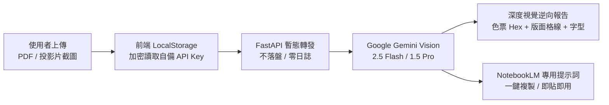

<div align="center">

# 🎨 NBLM 簡報風格逆向工程器
### Presentation Style Reverse-Engineer to NotebookLM Prompt

<p align="center">
  <strong>看見喜歡的簡報風格？上傳 PDF 或圖片截圖，AI 深度逆向視覺語意與排版結構，一鍵產出最適配 NotebookLM 的高精度提示詞！</strong>
</p>

[](LICENSE)
[](https://python.org)
[](https://fastapi.tiangolo.com)
[](https://aistudio.google.com)
[](Dockerfile)
[](#-資安防護保證-zero-storage--byok)

</div>

---

## 🌟 核心理念與亮點

許多人在做簡報時，手邊有大量文字筆記想用 **NotebookLM** 整理，但往往缺乏好看的排版與視覺指示；或者在網路上看到極度欣賞的投影片風格（如蘋果發布會風、Bento Grid 模組化卡片風、日系知性留白雜誌風），卻不知道該如何用文字精確向 AI 描述。

**本專案專為解決此痛點而生：**
* 📤 **全格式支援**：支援上傳多頁簡報 PDF，或多張投影片截圖（PNG / JPG / WEBP）。
* 📑 **PDF 頁面即時預覽**：內建 PyMuPDF 引擎，上傳 PDF 後自動提取前幾頁高畫質縮圖供即時檢視。
* 🔍 **設計師維度深度逆向**：
  * **色彩系統 (Palette)**：精準推導 Hex 代碼（背景、文字、主色、強調色），點擊色票即可一鍵複製色碼！
  * **版面與格線 (Layout & Grid)**：解析留白比例（White-space %）、卡片邊界、非對稱或多欄排版規則。
  * **字型層級 (Typography)**：大標題、副標題與正文的對比比率與標籤修飾特徵。
  * **視覺質素 (Visual Accents)**：冷光漸層、毛玻璃、膠囊徽章與圖表表現形式。
* 📋 **NotebookLM 專屬系統提示詞**：結構化 Markdown 模板，一鍵複製直接貼入 NotebookLM。
* 🛡️ **資安第一 (BYOK & Zero-Storage)**：
  * **零伺服器儲存**：使用者的 API Key 僅儲存於本地瀏覽器 LocalStorage。
  * **公開部署安心無虞**：部署上線或分享給親友使用時，作者金鑰絕不洩漏，訪客各自使用自己的免費 Key。

---

## 🔄 運作架構圖



---

## 🚀 快速上手 (Quick Start)

### 方式一：Windows 桌面一鍵雙擊啟動（推薦）
1. Clone 或下載本專案至本地。
2. 雙擊執行目錄下的 **`啟動簡報風格逆向器.bat`**。
3. 瀏覽器將自動開啟 `http://127.0.0.1:8000`。

### 方式二：指令列手動啟動

```bash
# 1. Clone 專案
git clone https://github.com/<YOUR_USERNAME>/nblm-slide-reverser.git
cd nblm-slide-reverser

# 2. 安裝相依套件
pip install -r requirements.txt

# 3. 啟動伺服器
python app.py
```

### 方式三：Docker 容器化部署

```bash
# 建立映像檔並啟動
docker compose up -d

# 服務將運行於 http://localhost:8000
```

---

## 🔑 免費申請 Google Gemini API (1 分鐘圖文指南)

本工具核心使用 Google Gemini 官方多模態視覺模型，Google 提供每位開發者極為充裕的 **Free Tier（免費額度），完全無須綁定信用卡**：

1. **前往 Google AI Studio**：👉 [https://aistudio.google.com/app/apikey](https://aistudio.google.com/app/apikey)
2. **登入 Google 帳號**。
3. 點擊 **「Create API key」** ➔ 選擇 **「Create API key in new project」**。
4. 複製生成的金鑰（`AIzaSy...` 開頭）。
5. 回到本網站，點擊右上角 **「設定 Gemini Key」** 貼上並儲存，即可開始使用！

> 詳細圖文解說請參閱 [API_GUIDE.md](API_GUIDE.md)。

---

## 🛡️ 資安防護保證 (Zero-Storage / BYOK)

當您把這個專案公開部署到 GitHub、Render 或 Hugging Face Spaces 並分享給社群時：

| 資安維度 | 防護機制 |
| :--- | :--- |
| **金鑰儲存** | **絕不落盤**。金鑰僅儲存於使用者個人瀏覽器的 `localStorage`。 |
| **伺服器後端** | 每次 API 呼叫以請求 Header 暫存於記憶體，分析結束即從 RAM 銷毀，無任何日誌留存。 |
| **防止作者 Key 外洩** | 專案預設不提供任何內嵌金鑰。訪客必須自行攜帶免費金鑰（BYOK），**絕對無法碰觸作者金鑰與配額**。 |
| **開源程式碼** | `.gitignore` 已嚴格配置防護，阻絕所有 `.env` 或個人密鑰意外提交。 |

---

## 💡 如何將產出的提示詞套用至 NotebookLM？

1. **一鍵複製**：在逆向分析完成面板中，點擊「📋 一鍵複製提示詞」。
2. **打開 NotebookLM**：前往 [NotebookLM 官網](https://notebooklm.google.com/)。
3. **建立筆記並上傳來源資料**：上傳您的企劃案、論文或筆記。
4. **貼入提示詞**：
   在聊天視窗貼上剛複製的提示詞，並送出指令：
   > *「請嚴格依據上述風格規範與排版結構，將我上傳的來源筆記整理成 5 頁核心投影片大綱與文案。」*
5. NotebookLM 即會依據該視覺風格的節奏、卡片佈局與字數限制輸出完美內容！

---

## 🛠️ 技術堆疊 (Tech Stack)

* **後端引擎**：Python 3.10+, FastAPI, PyMuPDF (fitz), Pillow, Google GenAI SDK (`google-genai`)
* **前端介面**：TailwindCSS, Lucide Icons, Marked.js (Markdown 解析器), 原生 Vanilla JS (輕量零建置)
* **容器化**：Docker, Docker Compose
* **持續整合**：GitHub Actions CI

---

## 📄 開源授權 (License)

本專案採用 [MIT License](LICENSE) 授權，歡迎自由修改、分享或整合至您的個人或商業專案中。
